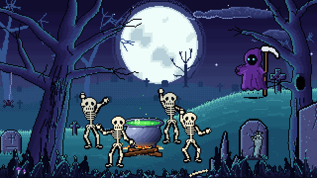

# Creative Lab

Animation, pixel art and creative-coding experiments by Dmitrii Parkhachev, built with Claude Code.
Each folder is one project with its own README, live demo and the story of how it was made.

| Project | What it is |
|---|---|
| [Halloween Projector](halloween-projector/) · [live](https://obiwandima-web.github.io/creative-lab/halloween-projector/) | A live 8-bit graveyard for a party projector: skeletons dance to the music, the reaper casts on the drop, scares on every track change, an AI-video teaser every 20 minutes. |

More projects are on the way.
