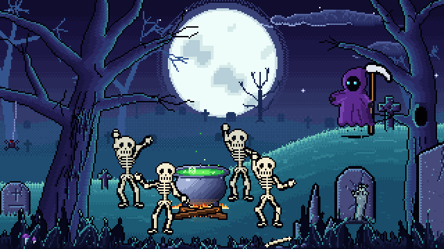
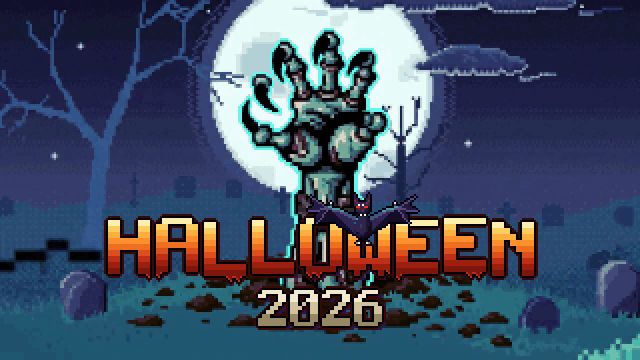
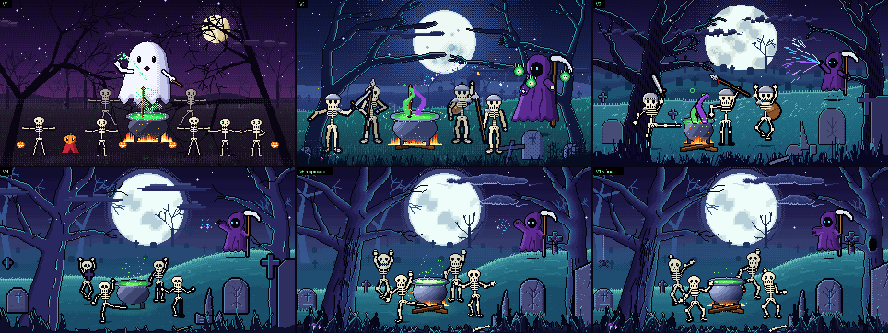

# Halloween Projector — a live 8-bit scene that listens to the music

**[▶ Open the live scene](https://obiwandima-web.github.io/creative-lab/halloween-projector/)** — press *Демо-бит* (demo beat) to start, **F** for fullscreen.



A pixel-art graveyard made for a house party (31 October 2026), projected on a wall for the whole night.
It is not a video loop: the scene is drawn live in the browser, so it never repeats, and it reacts to whatever music is playing.

- **Four skeletons dance** round a cauldron to the beat: they hold a place for 5–10 s and then move on round the ring in one of four ways (walk, skip, spin, slide), with an occasional somersault. Feet stay planted thanks to two-bone IK and damped springs.
- **The reaper is an idle NPC** that floats on the hill. When the music drops (the bass comes back after a quiet bar), he raises an arm and casts into the cauldron: it boils over in a glowing geyser and the fire flares.
- **Every track change triggers a scare**: a BOO screamer, a cat yowl, a wolf howl with a glowing moon, or evil laughter. The same kind never comes twice in a row.
- **Small surprises on timers**: a spider on a branch, eyes in a tree hollow, a faint ghost over the graves, a zombie hand reaching up by the rune grave.
- **A teaser every 20 minutes**: the skeletons run back to their marks, the scene freezes into exactly the first frame of an AI-generated video (Veo 3.1), a zombie hand bursts out in front of the moon, thunder, a *HALLOWEEN 2026* title with a bat landing on the digits. Then the video returns to that same frame and the live scene carries on with no visible cut.

| BOO screamer | Teaser title |
|---|---|
|  |  |

## How it was made

From V1 to V15 in a few days, one round of notes at a time. Every version is still in the code: open the page with `?v=1` … `?v=14` to see it.



1. **Look (V1–V6).** The first take was a white ghost in a purple forest. A single style reference then set the target: a moonlit blue-teal graveyard. The picture was reviewed on a page where each element (every tree limb, grave, pose) could be pinned and commented separately, and V6 was approved.
2. **Motion (V7–V8).** Dancers moved from sliding sprites to IK legs with springs and a choreography plan. The BOO scare became a flipbook of six frames from a sheet generated in Nano Banana ([sheet](docs/process/boo-sheet.jpg)), snapped to a clean pixel grid by a small Python pipeline ([check](docs/process/check.png)).
3. **Sound and life (V9–V12).** CC0 sounds, set as dB levels so the scares sit under the music. The moon glows on the howl, a spider, eyes, a ghost and a zombie hand come on their own timers.
4. **Teaser (V13–V15).** The live scene was exported as the first and last frame for a video model ([prompt](docs/process/PROMPTS.md)), and the generated clip was converted back into the scene's own 255-colour palette. Clouds drift a whole number of laps every 20 minutes, so at that moment the frame matches the video exactly.

## Under the hood

- Plain JavaScript and one `<canvas>` with no framework. The scene is drawn at about 320×180 and scaled up with crisp pixels. It adapts to any projector shape.
- `js/scene.js` — everything you see: palette, trees, graves, the rigged skeletons, the reaper, scares and the teaser. `js/px.js` is a small pixel buffer (blits, outlines, Bayer dither, discs).
- `js/audio.js` — the "ears": hears the music from the microphone, from your own files or from a built-in demo beat. Finds the beat (bass onsets plus tempo lock) and the drops.
- `js/sfx.js` — scare sounds over Web Audio. `server.mjs` — a tiny local server that asks Spotify / Apple Music for the current track (AppleScript, macOS) so scares land exactly on track changes.
- `tools/` — renders the scene offline to MP4 or GIF with a demo beat (`node tools/clip.mjs out.gif --dur 8 --scale 2`), to stills, and the Python scripts that turned the screamer and the video into scene pixels.

## Run it

Open the [live page](https://obiwandima-web.github.io/creative-lab/halloween-projector/) and press **▶ Демо-бит** (demo beat), **🎤** (microphone) or drop some mp3s on it. Keys: **F** fullscreen, **Space** a scare, **C** the reaper's spell, **7 / 8 / 9** the teaser now, **H** sensors.

For a party with Spotify or Apple Music on a Mac:

```bash
node server.mjs
```

Then open http://localhost:8031. The menu is in Russian, the party was too.

## Credits

Sounds are CC0 from Freesound and OpenGameArt, listed in [sounds/CREDITS.md](sounds/CREDITS.md). The teaser clip was generated with Veo 3.1 Fast from frames of this scene. The BOO screamer frames were generated with Nano Banana and redrawn on the pixel grid. Code written together with Claude Code.

## License

Code under the [MIT License](../LICENSE): use it, change it, build on it. The sounds keep their own CC0 terms.
